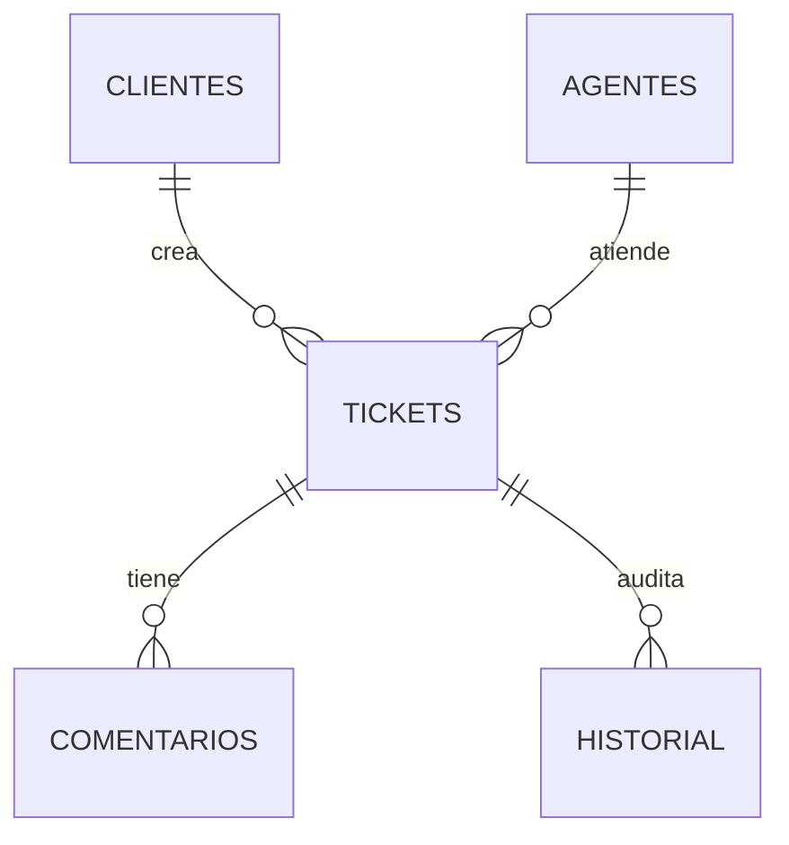

# Laboratorio 2 — HELPLINE Mesa de ayuda con SLA

**Caso elegido:** Caso 4, mesa de ayuda con SLA e historial. **Modalidad:** individual. **Stack:** React + Vite + React Router, Node.js + Express, SQLite relacional (SQLite está permitido por el enunciado), n8n AI Agent.

## Fases de desarrollo

### Día 1 — base de datos y API
1. Modelo relacional de cinco tablas, restricciones PK/FK/CHECK e índices en `schema.sql`.
2. Datos de ejemplo con tres clientes, cuatro agentes y tres tickets.
3. API REST por capas `routes/controllers/services` (controlador con Express Router) y transacciones `BEGIN IMMEDIATE / COMMIT / ROLLBACK`.
4. Reglas: SLA alta 4 h, media 24 h, baja 72 h; transición secuencial; comentario obligatorio para resolver; asignación al agente activo del área con menos tickets abiertos; historial auditable.
5. Pruebas automatizadas y colección Postman, incluyendo 400, 404 y 409.

### Día 2 — React y agente n8n
1. Dashboard con métricas SQL de estado, carga, cumplimiento SLA, vencidos y horas promedio.
2. Vistas: panel, tickets, crear, editar, detalle, equipo. Búsqueda, filtro de estado y ordenamiento.
3. Formularios controlados y `useFetch` con cargando/error/datos.
4. Workflow importable de n8n con `Webhook → AI Agent (+ OpenAI Chat Model) → Code (validación) → Respond to Webhook`.
5. Integración: React → Express `/api/ia/analizar` → n8n webhook → Express → React. No hay credenciales embebidas.

## Requisitos

- Node.js **22.13+**, recomendado **24** (usa `node:sqlite` integrado; no requiere SQLite instalado por separado).
- npm y n8n instalado localmente o en Cloud para el agente.
- Una credencial válida de OpenAI configurada por ti **dentro de n8n**; no viene en el ZIP.

## Inicio rápido

Desde la raíz de este proyecto:

```bash
npm run install:all
```

En dos terminales diferentes:

```bash
npm run dev:api
npm run dev:web
```

Abre `http://localhost:5173`. La API estará en `http://localhost:3001` y escucha solo en `127.0.0.1` por defecto. La base `backend/soporte.sqlite` se crea automáticamente al iniciar y carga `schema.sql`; las fechas existentes se migran a UTC al arrancar.

Antes de iniciar la API, copia `backend/.env.example` como `backend/.env` y completa `AUTH_USERNAME`, `AUTH_PASSWORD` (mínimo 12 caracteres) y `AUTH_SECRET` (mínimo 32 bytes). Genera un secreto aleatorio con `node -e "console.log(require('node:crypto').randomBytes(32).toString('hex'))"` y guarda el resultado en `AUTH_SECRET`. El frontend solicitará inicio de sesión; la sesión se guarda en una cookie HttpOnly y vence después de ocho horas. La API rechaza solicitudes sin sesión.

Para cambiar puertos o endpoints, copia también `frontend/.env.example` como `frontend/.env`. Nunca subas los archivos `.env` ni compartas sus secretos. Esta práctica usa una cuenta administradora configurada por variables de entorno; para varios usuarios, roles o despliegue público, añade gestión de identidades, HTTPS y controles operativos adecuados. Si despliegas detrás de un proxy HTTPS, configura explícitamente `HOST` para la interfaz de red requerida y no expongas el servidor directamente a Internet.

### n8n

1. Abre n8n e importa `n8n/soporte-ai-agent.json` desde **Import from File**.
2. Abre **OpenAI Chat Model** y selecciona/configura tus credenciales. Puedes sustituir el modelo por otro compatible.
3. Activa el workflow. Copia su URL de **Production Webhook** y configúrala como `N8N_WEBHOOK_URL` en `backend/.env` (ejemplo local: `http://localhost:5678/webhook/soporte-ia`). Reinicia Express.
4. En el detalle de un ticket, pulsa **Analizar con IA**. La respuesta muestra prioridad, área y texto sugerido. El técnico **debe revisarlo**: la IA nunca cambia tickets automáticamente.
5. Para pruebas sin activar el workflow, usa la **Test URL** (`/webhook-test/soporte-ia`) y pulsa **Listen for test event** en n8n antes de enviar.

Contrato de solicitud del webhook: `{ "ticket": { "id": 1, "titulo": "...", "descripcion": "...", "area": "software", "prioridad": "alta" } }`. Solo se remiten esos cinco campos; no se envían cliente, agente, comentarios ni historial. El título y la descripción son texto libre y aún podrían incluir datos personales o confidenciales: revísalos y anonimízalos antes de usar el análisis con un proveedor externo. El backend exige HTTPS para webhooks fuera del equipo local. Contrato de respuesta: `{ "ok": true, "data": { "prioridad": "alta", "area": "software", "respuesta": "..." }, "error": null }`.

## Modelo entidad relación



## Endpoints

| Método | Ruta | Función |
|---|---|---|
| POST | `/api/auth/login` | Iniciar sesión y crear cookie HttpOnly |
| GET/POST | `/api/auth/session`, `/api/auth/logout` | Consultar sesión y cerrarla |
| GET/POST | `/api/clientes`, `/api/agentes` | Listar y crear |
| GET/PUT/DELETE | `/api/clientes/:id`, `/api/agentes/:id` | Consultar, editar, eliminar |
| GET/POST | `/api/tickets` | Listar, crear |
| GET/PUT/DELETE | `/api/tickets/:id` | Detalle relacionado, editar, eliminar |
| POST | `/api/tickets/:id/asignar` | Asignación automática y transición |
| PATCH | `/api/tickets/:id/estado` | Cambiar estado válido |
| POST | `/api/tickets/:id/comentarios` | Comentar / documentar resolución |
| GET | `/api/resumen` | Métricas SQL (`COUNT`, `GROUP BY`, `AVG`) |
| POST | `/api/ia/analizar` | Invocar agente n8n |

Todas las rutas de error responden `{ "error": "mensaje" }`. Éxito de creación `201`, lectura/edición `200`, entradas inválidas `400`, recursos ausentes `404`, conflictos `409`.

## Probar y demostrar

```bash
npm test
npm run build
```

Importa `postman/Laboratorio2_Soporte.postman_collection.json` en Postman. Configura las variables de colección `authUsername` y `authPassword`; ejecuta primero **Iniciar sesión** para que Postman guarde la cookie. Demuestra el flujo: crear ticket → asignación → error 409 al intentar resolver sin comentario → registrar comentario de resolución → resolver → cerrar; revisa el historial y el panel.

**Advertencias importantes:** el workflow n8n necesita tus credenciales y una instancia n8n activa. No se puede afirmar que la IA funcione en vivo hasta probarla en tu instalación. La autenticación incluida protege una sola cuenta administradora y guarda sesiones en memoria; no ofrece gestión multiusuario ni sesiones compartidas entre instancias. Para exponer el sistema fuera del equipo local, usa HTTPS, secretos fuertes fuera del repositorio y una solución de identidad y despliegue adecuada. La eliminación de tickets es física, tal como el CRUD solicitado; úsala solo para esta práctica.
